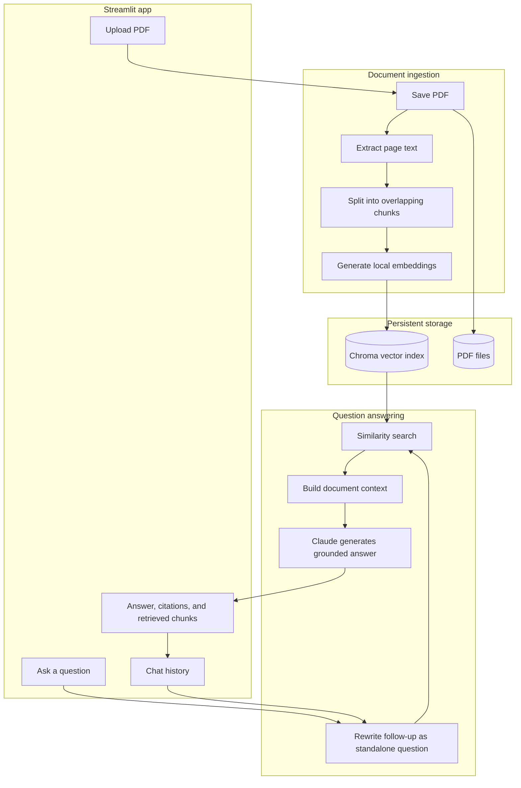

# DocuMind

DocuMind is a Streamlit "chat with your documents" application. It extracts text
from PDFs, stores locally generated embeddings in a persistent Chroma index, and
answers questions with Claude using retrieved document context.

## Setup

1. Use Python 3.11 or newer.
2. Create and activate a virtual environment.
3. Install dependencies:

   ```powershell
   python -m pip install -r requirements.txt
   python -m pip install -e .
   ```

4. Copy `.env.example` to `.env` and set `ANTHROPIC_API_KEY`. You can override
   the Claude model, embedding model, chunk size, overlap, top-k, and data paths
   there as well.
5. Add PDFs through the app, or place them in `data/documents`.

The first use of the local embedding model may download model files. Scanned
PDFs without an OCR text layer are reported as unextractable; OCR is not
currently included.

## Run

From the project root, start the Streamlit UI:

```powershell
python -m streamlit run app.py
```

The vector index persists under `data/chroma` and survives app restarts. The UI
lists indexed PDFs, lets you delete a document and its indexed chunks, displays
retrieved chunks, and keeps the current chat history in the Streamlit session.

Run offline tests with:

```powershell
python -m pytest
```

To evaluate configured question/expected-answer pairs, edit
`eval/questions.json` for your document corpus and run:

```powershell
python eval/run_eval.py
```

Evaluation calls Claude and may incur API charges. Its hit rate is a simple
case-insensitive expected-phrase match, not a semantic quality metric.

## Architecture



- `src/documind/config.py` loads validated environment settings.
- `src/documind/ingest.py` loads PDFs, rejects files with no extractable text,
  chunks pages, and skips files already indexed.
- `src/documind/retriever.py` owns persistent Chroma access, similarity search,
  indexed-file listing, and deletion.
- `src/documind/memory.py` formats chat history and rewrites follow-up questions
  as standalone questions before retrieval.
- `src/documind/chain.py` retrieves evidence, asks Claude for a grounded answer,
  and formats page citations as `[file, p.N]`.
- `app.py` contains the Streamlit interface only. Future services can import
  the `documind` package without depending on Streamlit.

The editable install exposes `src/documind` to the Streamlit app, tests, and
future API entry points. No Streamlit or UI imports are needed to use the
package from another Python entry point.
